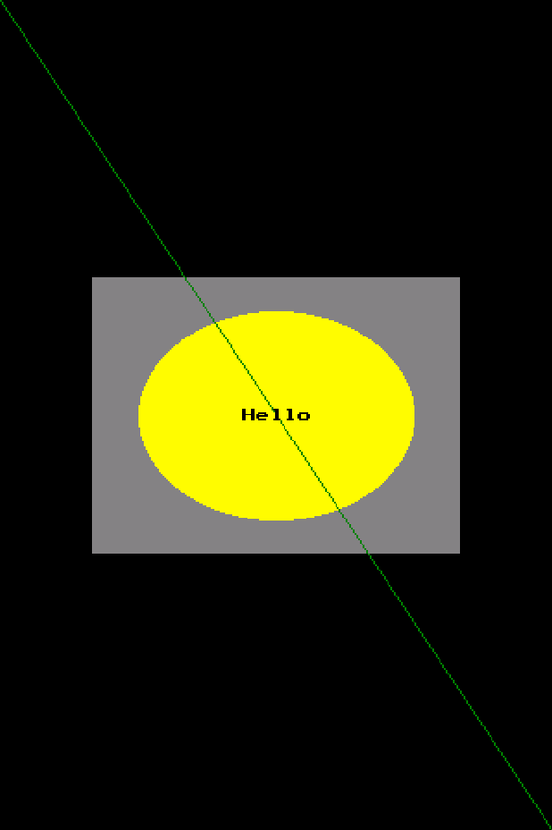

# Your first program

This draws a few shapes and a word on the display your `board_config` names.
On a desktop that is a window at the desktop config's 320 x 480.



Install the packages first ([Install](install.md)), then save this as
`hello_shapes.py`:

```python
import board_config
import appdev
import pygraphics
from palettes import get_palette

display = board_config.display_drv
pal = get_palette()
w, h = display.width, display.height
print(f"drawing on a {w}x{h} display")

pygraphics.fill(display, pal.BLACK)
pygraphics.fill_rect(display, w // 6, h // 3, w * 2 // 3, h // 3, pal.GREY)
pygraphics.ellipse(display, w // 2, h // 2, w // 4, h // 8, pal.YELLOW, True)
pygraphics.line(display, 0, 0, w - 1, h - 1, pal.GREEN)
pygraphics.text(display, "Hello", (w - 40) // 2, h // 2 - 4, pal.BLACK)
display.show()

app = appdev.App(board_config)  # keeps the window open until you close it
```

Run it from the folder you saved it in:

```bash
.venv/bin/python hello_shapes.py
```

It prints the size of the display and opens the window above:

```text
drawing on a 320x480 display
```

## What each part does

`board_config` is the module that describes your hardware. On a desktop the
`pydevices-desktop` package supplies one; on a board, a board package does.
Its `display_drv` is the display, so the same script draws on a window or on a
panel. `pygraphics` draws into it and `palettes` names the colors.
`display.show()` pushes the drawing to the screen.

`appdev.App(board_config)` is the optional coordinator the non-LVGL examples
use for events and timers. It keeps the program alive after the last line, so
the window stays open. [Application ownership](../how-it-works/index.md#application-ownership)
says why the examples build it themselves.

## Next

Run `lib/examples/pydevices_demo.py` from a clone, then pick another from
[`lib/examples/`](https://github.com/PyDevices/pydevices-examples/tree/main/lib/examples).
The [screenshots](../reference/screenshots.md) show what many of them draw.
