# Screenshots

What the examples draw, captured from a desktop run, a phone or an installed PWA.

| Image | Image | Image |
|-------|-------|-------|
|  |  |  |
|  |  |  |
|  |  |  |
|  |  | 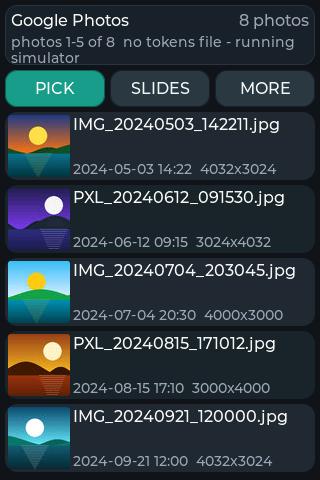 |
| 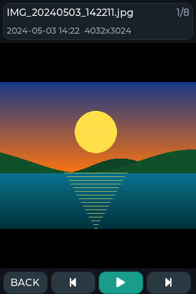 | 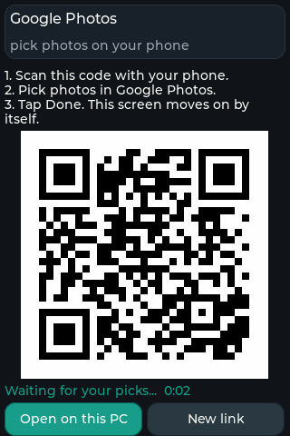 | 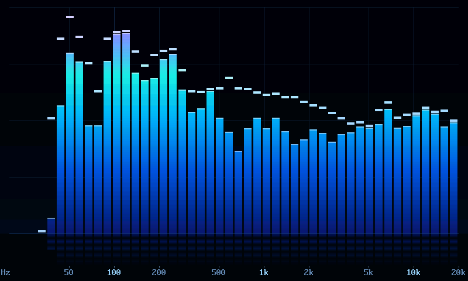 |
| 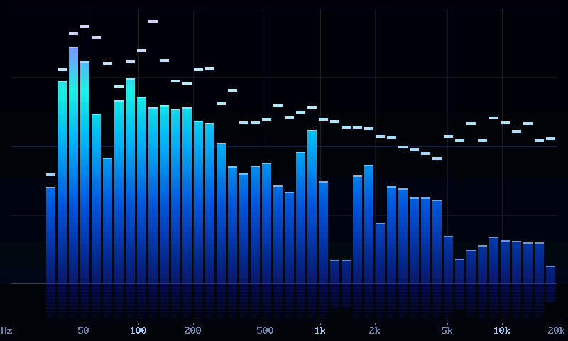 | 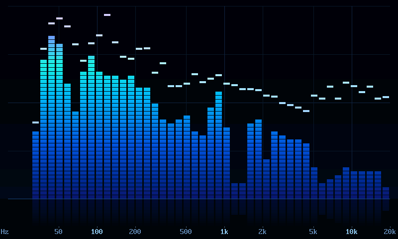 | 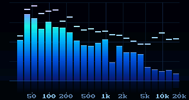 |
|  |  |  |

On Android (the PyDevices Runner) and as an installed PWA:

| Image | Image | Image |
|-------|-------|-------|
| 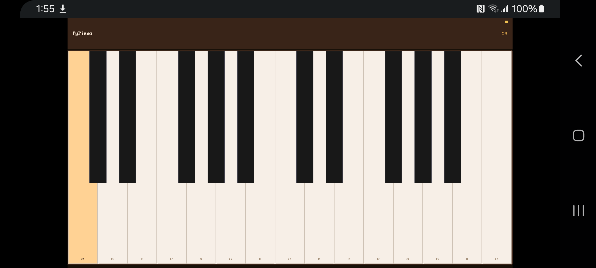 | 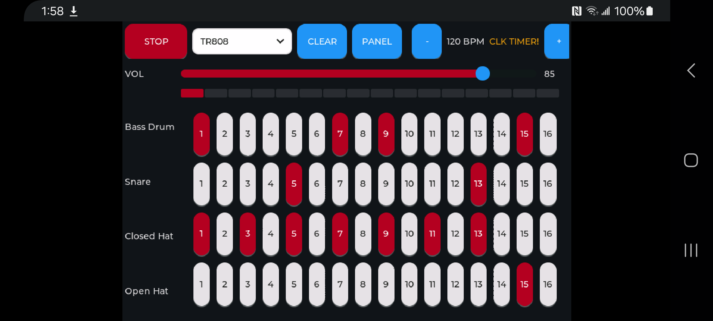 | 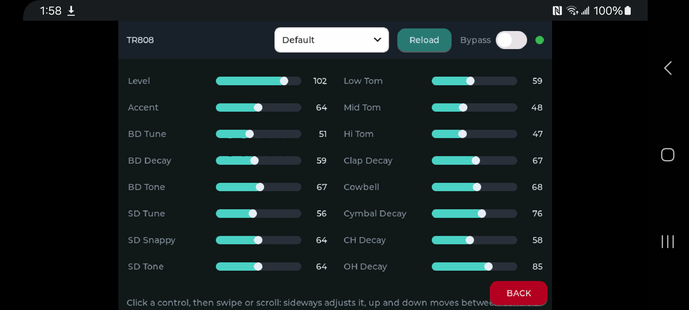 |
| 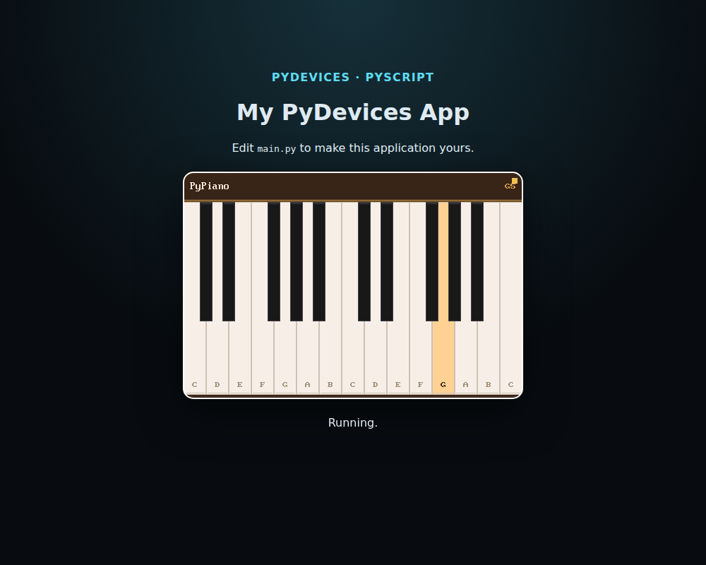 | 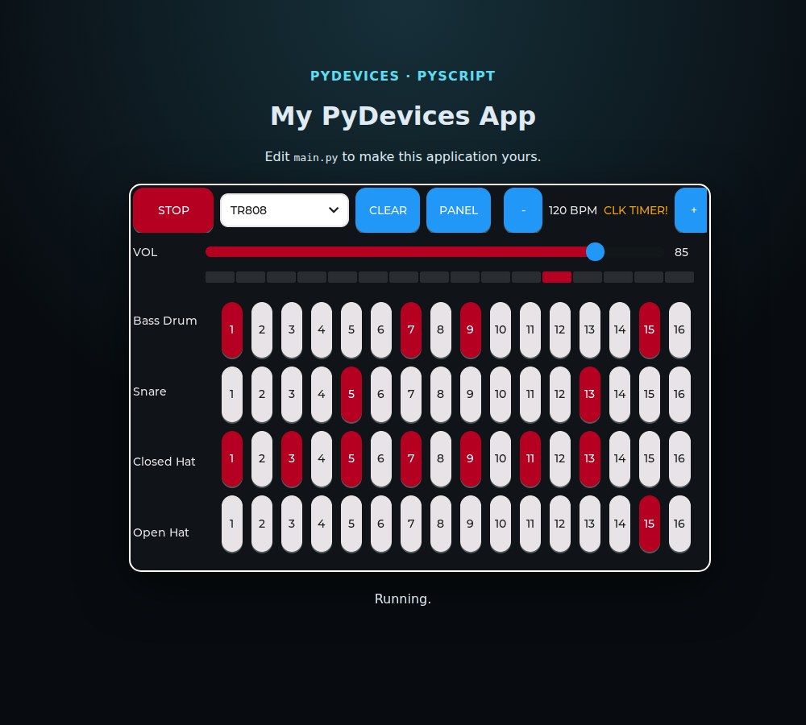 | 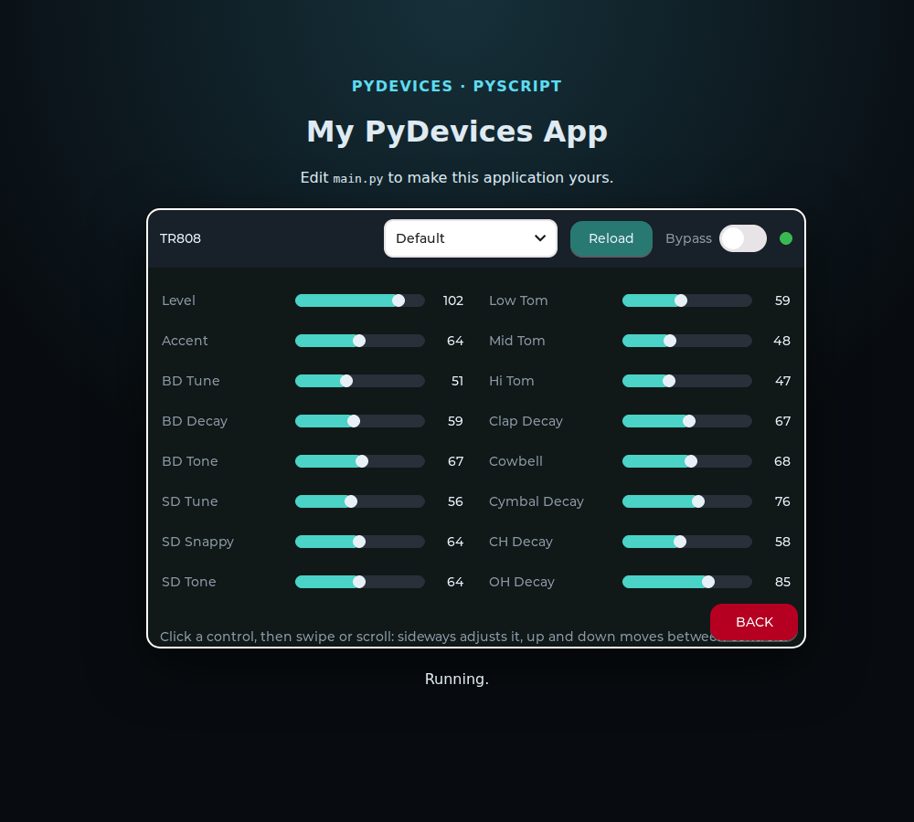 |
| 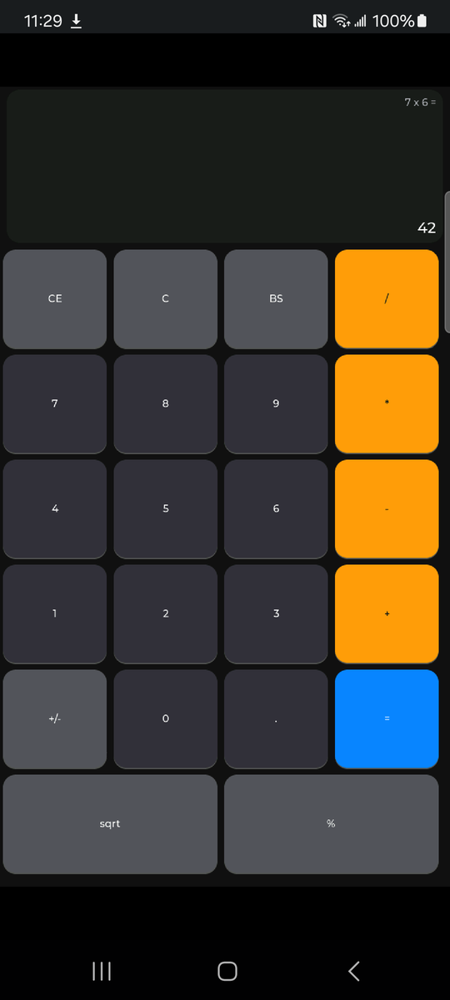 | 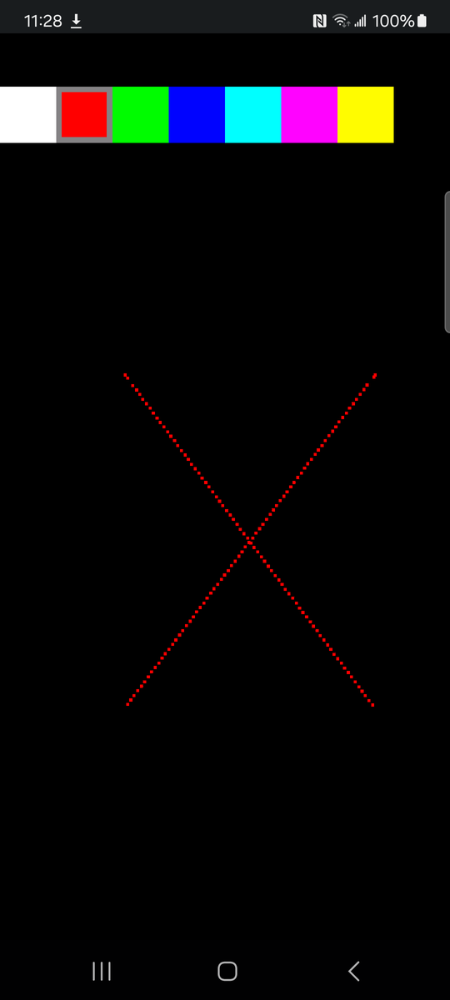 |  |

The sensor hub and the fleet page ([sensor hub](https://github.com/PyDevices/pydevices-examples/blob/main/lib/examples/sensor_hub/README.md) and [fleet page](https://github.com/PyDevices/pydevices-examples/blob/main/lib/examples/fleet_page/README.md)). The mobile shot is a phone-sized browser on the PC:

| Image | Image | Image |
|-------|-------|-------|
| 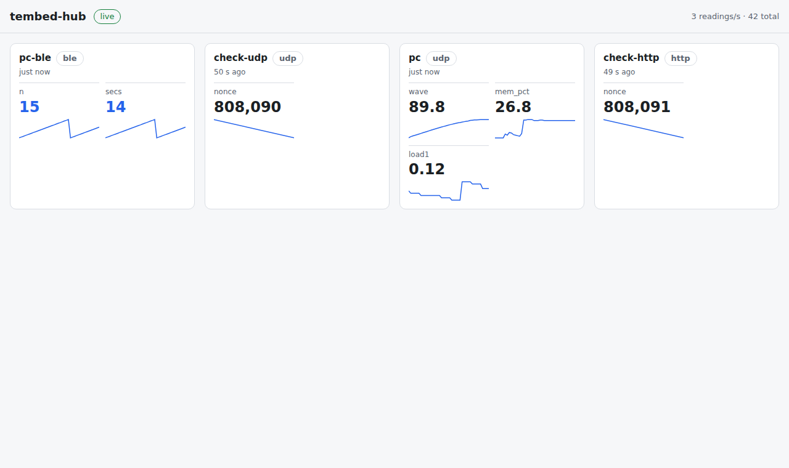 | 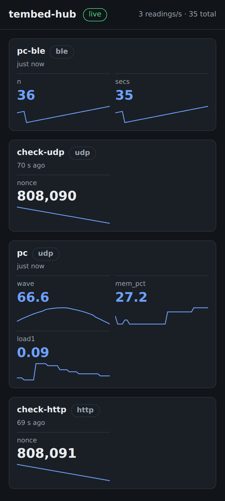 | 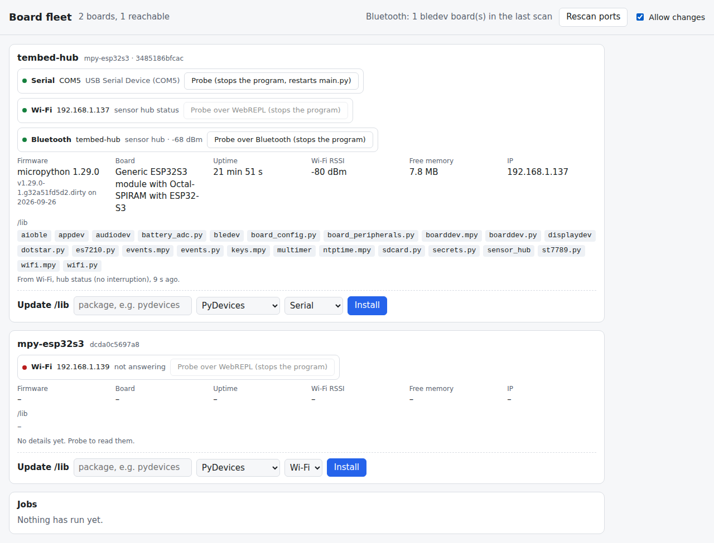 |
